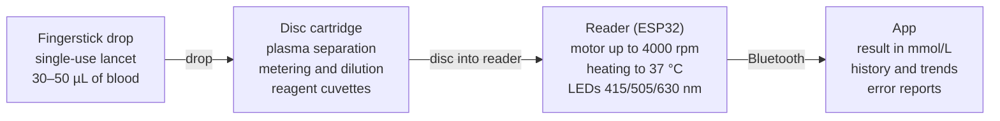

# Home Blood Analyzer: Prototype Technical Concept

**English** · [Українська](README.uk.md)

> **Disclaimer.** This is an engineering concept and a research bench, not a medical device. Prototype results must not be used for diagnosis, treatment decisions, or changing medication doses.

The idea: make blood testing at home accessible, and not just glucose for diabetics. The device works like an "inkjet printer in reverse": a lancet takes a small drop of blood, the drop goes into a disposable cartridge, and the cartridge splits it across several chambers holding different reagents.

## Prototype goal and scope

The prototype has to prove one thing: from a single fingerstick drop (30–50 µL), the device separates plasma on its own, splits it into several reagent chambers, and reads the result. We start with the two simplest tests: **glucose** and **total cholesterol**.

Why these two: both are enzymatic color reactions read at the same wavelength (~505 nm), reagent kits are cheap and easy to get, and results are easy to check against a glucose meter and a clinical lab. If the architecture works for two chambers, it scales to 4–10.

**Success criterion:** results within ±15% of a lab result from the same blood, for both analytes, on 20+ samples.

**What the prototype does NOT do:** it makes no diagnosis and is not used for treatment or dosing decisions. It is an engineering bench to prove the principle.

## System architecture

The system has four parts, and only one of them, the disc cartridge, is disposable. The rest is a reusable device and a phone, like a printer and its cartridges.

The cartridge holds all the chemistry and all the "plumbing"; the reader only supplies rotation, heat and light. So a new test means a new cartridge, not a new device.

## Cartridge: centrifugal disc

The cartridge is a single-use disc about 60 mm in diameter. Rotation moves all the liquid inside it, so the disc needs no pumps and no electronic valves. This principle (lab-on-a-disc) is already proven in clinical analyzers such as the Piccolo Xpress.

All volumes below are starting estimates, to be refined experimentally on the first discs.

**Liquid path through the disc:**

1. **Inlet chamber (~50 µL).** The fingerstick drop is drawn in by capillary action and the lid is closed.
2. **Plasma separation.** Spin at 3000–4000 rpm for 1–2 min. Red cells move outward into a trap; plasma stays closer to the center. From 40 µL of blood at 45% hematocrit, 10–15 µL of plasma is realistic.
3. **Metering chamber.** Measures a fixed plasma volume (e.g., 5 µL); the excess drains into an overflow chamber. This step decides the accuracy.
4. **Dilution.** An on-board blister releases buffer (~100–200 µL), mixed with the plasma by speeding up and slowing down.
5. **Distribution to cuvettes.** Diluted plasma flows into 2–4 cuvettes of ~20 µL, each holding a dried pellet of its reagent. A separate cuvette with no sample serves as the blank.
6. **Reading.** The cuvettes pass one by one under the reader's optics.

**Valves.** Capillary ("burst") valves are narrowed or hydrophobic channel sections that let liquid through only above a set speed. A single variable, motor speed, thus drives the whole sequence.

**Materials and fabrication:**

| Option | How it is made | Smallest channel | When to use |
| --- | --- | --- | --- |
| PMMA layers + double-sided tape (PSA) | Laser-cut 1–2 mm sheets, laminated | ~200–300 µm | First iterations: cheap, fast, transparent |
| Resin 3D printing (SLA/DLP) | Clear resin print, polished cuvettes | ~300–500 µm | Complex 3D channel geometry |
| Injection molding (PC, COC) | Steel mold | <100 µm | Series production only |

Channel surfaces must be made hydrophilic (plasma treatment or coating), or plasma will not flow by capillary action.

## Chemistry: two enzymatic reactions

Both tests are classic Trinder reactions: an enzyme produces hydrogen peroxide, and peroxidase turns it into a pink dye (quinoneimine). Color intensity is proportional to concentration, so the same optical channel reads both tests.

| Parameter | Glucose (GOD-POD) | Cholesterol (CHOD-PAP) |
| --- | --- | --- |
| Enzymes | glucose oxidase + peroxidase | cholesterol esterase + cholesterol oxidase + peroxidase |
| Chromogen | 4-aminoantipyrine + phenol | 4-aminoantipyrine + phenol |
| Wavelength | ~505 nm | ~500–505 nm |
| Incubation | ~5 min at 37 °C | ~5 min at 37 °C |
| Method | end point | end point |
| Reference range for comparison (adults) | 3.9–5.5 mmol/L fasting | < 5.2 mmol/L desirable |

**Where to get reagents.** Nothing has to be synthesized at first: use ready-made liquid kits for clinical analyzers from local lab-diagnostics distributors (100–500 tests per kit). They include a calibrator of known concentration. Later, reagents are freeze-dried into pellets directly in the cuvettes.

**Quality control in every disc:**

- **Blank** — a cuvette with reagent and no sample, to subtract the reagent's own color.
- **Reference wavelength** (~630–660 nm) — subtracts turbidity and bubbles.
- **Hemolysis check** — plasma absorbance at ~415 nm (hemoglobin). If high, the result is rejected.
- **Control serum** with known values — for weekly checks of the bench.

**Known interferences:** hemolysis, high bilirubin, ascorbic acid (vitamin C lowers Trinder-reaction results).

## Reader: inside the device

The reader is the "printer" for the cartridge: it spins the disc, heats it to 37 °C, and measures color in each cuvette. One ESP32 microcontroller runs everything and sends the result to a phone over Bluetooth.

**Rotation and positioning.** A brushless gimbal motor (2804 class) with a driver and the SimpleFOC control library. This motor can both spin up to several thousand rpm and stop precisely to place a given cuvette under the optics. A magnet in the disc plus a Hall sensor sets the zero position.

**Optics.** Above the cuvette: LEDs at ~505 nm (main), ~630–660 nm (reference) and ~415 nm (hemolysis). Below it: an AS7341 spectral sensor or a photodiode with an amplifier. The optics enclosure is black and light-tight, since any stray light adds error.

**Temperature.** A film heater (Kapton, 5–10 W) under the disc, an NTC thermistor, and a PID loop in firmware. Target: 37 ± 0.5 °C, because enzyme reaction rates depend strongly on temperature.

**Firmware (sequence of one test):**

1. Warm up to 37 °C, check that a disc is inserted (Hall sensor).
2. Read the empty cuvettes — optical baseline.
3. Spin at 3500 rpm for 90 s — plasma separation.
4. Speed steps to open the valves: metering → dilution → distribution.
5. Incubate 5 min with slow rotation for mixing.
6. Read each cuvette at three wavelengths, subtract the blank.
7. Convert absorbance to mmol/L using the cartridge lot's calibration curve.
8. Send the result to the app, report errors (hemolysis, too little plasma, temperature).

Calibration coefficients for each reagent lot are stored in a QR code on the cartridge, as with glucose test strips.

## Bench components and budget

The first working bench costs roughly **$250–450**. Prices are approximate (not checked against current offers) and depend on the supplier.

| Component | What exactly | Approx., $ |
| --- | --- | --- |
| Micropipettes | 0.5–10 µL and 10–100 µL, used is fine | 60–120 |
| Reagent kits | glucose + cholesterol, 100–500 tests each, with calibrators | 30–70 |
| Control serum | normal + pathological level | 20–40 |
| Disc materials | PMMA sheets, double-sided tape (PSA), laser cutting service | 30–60 |
| Motor and driver | gimbal BLDC 2804 + SimpleFOC driver + Hall sensor | 25–40 |
| Optics | AS7341 + LEDs 415 / 505 / 630 nm | 20–30 |
| Heating | film heater, NTC, MOSFET | 10–15 |
| Controller and power | ESP32 DevKit, 12 V supply, small parts | 15–25 |
| Enclosure | 3D print (PETG), black for the optics block | 15–30 |
| Consumables | single-use lancets, tips, gloves, biohazard container | 15–25 |

The costliest part later is not electronics but time spent iterating discs: plan for 10–30 versions of the geometry.

## Development stages

Move from simple to complex; each stage has a clear criterion that must be met before moving on.

1. **Chemistry in a tube.** Glucose and cholesterol reactions per the kit instructions, read with a home-built photometer (505 nm LED + AS7341) in a standard cuvette.
    - Criterion: linear calibration curve (R² > 0.99), control serum within ±10%.
2. **Volume miniaturization.** The same reactions in 20 µL instead of 1 mL, in PMMA cuvettes.
    - Criterion: repeatability (CV) < 5% over 10 replicates.
3. **Disc without blood.** Centrifugal disc with colored water: test metering, valves, distribution to chambers.
    - Criterion: volume in each cuvette within ±5%, valves open in the right order 10 out of 10 times.
4. **Plasma separation.** Whole blood (your own, fingerstick) in the disc.
    - Criterion: ≥ 8 µL of plasma from 40 µL of blood, hemolysis below threshold.
5. **Full cycle.** Blood → plasma → metering → reactions → result on the phone.
    - Criterion: within ±15% of the lab on 20+ samples.
6. **Dry reagents.** Drying reagents in the cuvettes, storage stability testing.
    - Criterion: results change by no more than 10% after 4 weeks of storage.

Stages 1–3 can run in parallel: the chemistry and the disc mechanics do not depend on each other.

## Cost estimate to market

All figures are orders of magnitude, not checked against current prices or rates. They are for planning, not budgeting.

| Stage | What you get | Team and time | Approx. |
| --- | --- | --- | --- |
| 1. Bench (proof of principle) | Working disc + reader, lab comparison on 20+ samples | 1–2 people, 3–6 months | $1–3k |
| 2. Engineering prototype | Stable device, dry reagents, app, 5–10 units | 3–4 people, 6–12 months | $60–150k |
| 3. Production readiness | Disc mold, ISO 13485, verification, pilot batch | 5–8 people, 9–12 months | $250–600k |
| 4. Clinical studies and certification | Approval to sell for home use | 12–24 months | $0.5–1.5M (EU, IVDR) |

**Total to market with a glucose + cholesterol panel:** about $1–2.5M and 2.5–4 years. An immunoassay channel (e.g., valproate) adds roughly $0.5–2M.

**Unit cost at scale (from ~100k cartridges per year):**

- Reader: components $40–80, realistic retail price $150–300.
- Cartridge: cost $1–2.5, retail $4–10 depending on the number of tests in the panel. Reagents cost very little; most of the cost is molding, assembly and sealed packaging.

## Risks, safety, and the path to drug monitoring

**Safety during development:**

- Your own blood only, and only single-use sterile lancets. Used lancets, discs and tips go into a sharps/biohazard container.
- Some reagents contain phenol and the preservative sodium azide: wear gloves, avoid skin contact, do not pour down drains with metal pipes.
- Bench results are not used for treatment or dosing decisions.

**Main technical risks:**

| Risk | Why it matters | Mitigation |
| --- | --- | --- |
| Inaccurate metering of 1–5 µL | Volume error turns directly into result error | Overflow chamber, internal dye standard to check volume |
| Hemolysis from fingerstick sampling | Distorts color and several analytes | "Don't squeeze" instructions, 415 nm check, sample rejection |
| Too little plasma at high hematocrit | Chambers underfill | Fill sensing in the cuvette, an error instead of a wrong number |
| Dry reagent degradation | Results drift over time | Sealed packaging with desiccant, controls in every disc |

**Regulation (later stages).** Selling it as a medical device requires certification: in the EU, the IVDR; in Ukraine, the technical regulation on in vitro diagnostic medical devices. Requirements are strictest for home use: clinical accuracy studies on hundreds of people and a quality management system (ISO 13485).

**Path to drug monitoring (e.g., valproate).** Valproate gives no enzymatic color reaction; it is measured by **immunoassay**. Lab analyzers use homogeneous immunoassays (EMIT-type) read at 340 nm (ultraviolet). For the disc this means:

- a 340 nm UV LED and UV-transparent cuvette material (standard PMMA is a poor fit);
- antibody reagents, which are more expensive and licensed by analyzer makers;
- an alternative: a fluorescent competitive immunoassay with a separate optical channel.

So the logical order is: prove the disc on glucose and cholesterol, then add one immunoassay channel (valproate or another narrow-therapeutic-window drug).
