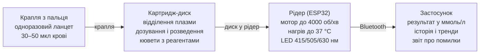

# Домашній аналізатор крові: технічний концепт прототипу

[English](README.md) · **Українська**

> **Застереження.** Це інженерний концепт і дослідницький стенд, а не медичний виріб. Результати прототипу не можна використовувати для діагностики, рішень щодо лікування чи зміни доз ліків.

Ідея: зробити аналіз крові вдома доступним, і не лише вимір цукру. Пристрій працює як «струменевий принтер навпаки»: ланцет бере малу краплю крові, вона потрапляє в одноразовий картридж, а той ділить її між кількома камерами з різними реагентами.

## Мета і межі прототипу

Прототип має довести одну річ: з однієї краплі з пальця (30–50 мкл) прилад сам відділяє плазму, ділить її на кілька камер з різними реагентами і зчитує результат. Для перевірки беремо два найпростіші аналізи: **глюкозу** і **загальний холестерин**.

Чому саме вони: обидві реакції ферментні й кольорові, читаються на одній довжині хвилі (~505 нм), набори реагентів дешеві й доступні, а результат легко звірити з глюкометром і лабораторією. Якщо архітектура працює для двох камер, вона масштабується на 4–10.

**Критерій успіху прототипу:** розбіжність з лабораторним результатом тієї ж крові не більше ±15% для обох показників на 20+ зразках.

**Чого прототип НЕ робить:** не ставить діагнозів і не використовується для рішень щодо лікування чи доз ліків. Це інженерний стенд для перевірки принципу.

## Архітектура системи

Система складається з чотирьох частин, і лише одна з них, картридж-диск, одноразова. Решта — багаторазовий прилад і телефон, як принтер і картриджі.

Картридж містить усю хімію і всю «сантехніку», рідер дає лише обертання, тепло і світло. Тому новий аналіз означає новий картридж, а не новий прилад.

## Картридж: центрифужний диск

Картридж — це одноразовий диск діаметром ~60 мм. Усю рідину в ньому рухає обертання, тому в диску немає насосів і клапанів з електронікою. Цей принцип (lab-on-a-disc) уже перевірений у клінічних аналізаторах на зразок Piccolo Xpress.

Усі об'єми нижче — стартові оцінки. Їх уточнюють експериментально на перших дисках.

**Шлях рідини в диску:**

1. **Вхідна камера (~50 мкл).** Крапля з пальця затягується капіляром, кришка закривається.
2. **Відділення плазми.** Обертання 3000–4000 об/хв протягом 1–2 хв. Еритроцити йдуть до краю в «пастку», плазма залишається ближче до центру. З 40 мкл крові при гематокриті 45% реально отримати 10–15 мкл плазми.
3. **Дозувальна камера.** Відміряє фіксований об'єм плазми (наприклад, 5 мкл), надлишок стікає в камеру переповнення. Саме тут вирішується точність.
4. **Розведення.** Зі вбудованого блістера вивільняється буфер (~100–200 мкл), змішується з плазмою підвищенням-зниженням обертів.
5. **Розподіл по кюветах.** Розведена плазма заходить у 2–4 кювети по ~20 мкл, у кожній — висушена таблетка свого реагенту. Окрема кювета без зразка слугує «бланком».
6. **Читання.** Кювети по черзі проходять під оптикою рідера.

**Клапани.** Капілярні («burst») клапани — звужені або гідрофобні ділянки каналу, які пропускають рідину лише вище певних обертів. Так одна змінна (швидкість мотора) керує всією послідовністю кроків.

**Матеріали і виготовлення:**

| Варіант | Як роблять | Мінімальний канал | Коли брати |
| --- | --- | --- | --- |
| Шари PMMA + двобічний скотч (PSA) | Лазерна різка листів 1–2 мм, склеювання | ~200–300 мкм | Перші ітерації: дешево, швидко, прозоро |
| Смоляний 3D-друк (SLA/DLP) | Друк прозорою смолою, полірування кювет | ~300–500 мкм | Складна 3D-геометрія каналів |
| Литво під тиском (PC, COC) | Прес-форма | <100 мкм | Тільки серійне виробництво |

Поверхню каналів роблять гідрофільною (плазмова обробка або покриття), інакше плазма не піде капілярами.

## Хімія: дві ферментні реакції

Обидва аналізи — класичні реакції Тріндера: фермент утворює перекис водню, а пероксидаза перетворює його на рожевий барвник (хінонімін). Інтенсивність кольору пропорційна концентрації. Тому один і той самий оптичний канал читає обидва тести.

| Параметр | Глюкоза (GOD-POD) | Холестерин (CHOD-PAP) |
| --- | --- | --- |
| Ферменти | глюкозооксидаза + пероксидаза | холестеролестераза + холестеролоксидаза + пероксидаза |
| Барвник | 4-аміноантипірин + фенол | 4-аміноантипірин + фенол |
| Довжина хвилі | ~505 нм | ~500–505 нм |
| Інкубація | ~5 хв при 37 °C | ~5 хв при 37 °C |
| Метод | кінцева точка | кінцева точка |
| Норма для звірки (дорослі) | 3,9–5,5 ммоль/л натще | < 5,2 ммоль/л бажано |

**Звідки взяти реагенти.** Для першого етапу не треба нічого синтезувати: беруться готові рідкі набори для лабораторних аналізаторів у місцевих дистриб'юторів лабораторної діагностики (на 100–500 визначень). У них є калібратор з відомою концентрацією. Пізніше реагенти висушують (ліофілізують) у таблетки прямо в кюветах.

**Контроль якості в кожному диску:**

- **Бланк** — кювета з реагентом без зразка: віднімає власний колір реагенту.
- **Референтна довжина хвилі** (~630–660 нм) — віднімає мутність і бульбашки.
- **Перевірка гемолізу** — поглинання плазми на ~415 нм (гемоглобін). Якщо висока, результат відкидається.
- **Контрольна сироватка** з відомими значеннями — для щотижневої перевірки стенду.

**Відомі інтерференції:** гемоліз, висока концентрація білірубіну, аскорбінова кислота (вітамін C знижує результат реакції Тріндера).

## Рідер: що всередині приладу

Рідер — це «принтер» у парі з картриджем: він крутить диск, гріє його до 37 °C і міряє колір у кожній кюветі. Усе керується одним мікроконтролером ESP32, результат іде на телефон по Bluetooth.

**Обертання і позиціювання.** Безколекторний gimbal-мотор (тип 2804) з драйвером і бібліотекою керування SimpleFOC. Такий мотор уміє і розкручуватися до кількох тисяч об/хв, і точно зупинятися, щоб поставити потрібну кювету під оптику. Нульову позицію задає магніт у диску + датчик Холла.

**Оптика.** Над кюветою — світлодіоди на ~505 нм (основний), ~630–660 нм (референтний) і ~415 нм (гемоліз). Під кюветою — спектральний сенсор AS7341 або фотодіод з підсилювачем. Корпус оптики чорний і світлонепроникний, бо будь-яке стороннє світло дає похибку.

**Температура.** Плівковий нагрівач (Kapton, 5–10 Вт) під диском, термістор NTC і ПІД-регулятор у прошивці. Ціль — 37 ± 0,5 °C, бо швидкість ферментних реакцій сильно залежить від температури.

**Прошивка (послідовність одного аналізу):**

1. Прогрів до 37 °C, перевірка, що диск вставлено (датчик Холла).
2. Читання «порожніх» кювет — оптична база.
3. Центрифугування 3500 об/хв, 90 с — відділення плазми.
4. Ступені обертів для відкриття клапанів: дозування → розведення → розподіл.
5. Інкубація 5 хв з повільним обертанням для перемішування.
6. Читання кожної кювети на трьох довжинах хвиль, віднімання бланка.
7. Перерахунок поглинання в ммоль/л за калібрувальною кривою партії картриджа.
8. Передача результату в застосунок, звіт про помилки (гемоліз, мало плазми, температура).

Калібрувальні коефіцієнти кожної партії реагентів зберігаються в QR-коді на картриджі, як у тест-смужках для глюкометрів.

## Компоненти і бюджет стенду

Перший робочий стенд обійдеться приблизно в **$250–450**. Ціни орієнтовні (без перевірки поточних пропозицій) і залежать від постачальника.

| Компонент | Що саме | Орієнтовно, $ |
| --- | --- | --- |
| Мікропіпетки | 0,5–10 мкл і 10–100 мкл, можна вживані | 60–120 |
| Набори реагентів | глюкоза + холестерин, по 100–500 визначень, з калібраторами | 30–70 |
| Контрольна сироватка | норма + патологія | 20–40 |
| Матеріали для дисків | листи PMMA, двобічний скотч (PSA), лазерна різка на замовлення | 30–60 |
| Мотор і драйвер | gimbal BLDC 2804 + драйвер SimpleFOC + датчик Холла | 25–40 |
| Оптика | AS7341 + світлодіоди 415 / 505 / 630 нм | 20–30 |
| Нагрів | плівковий нагрівач, NTC, MOSFET | 10–15 |
| Контролер і живлення | ESP32 DevKit, блок 12 В, дрібниці | 15–25 |
| Корпус | 3D-друк (PETG), чорний для оптичного блоку | 15–30 |
| Розхідники | одноразові ланцети, наконечники, рукавички, контейнер для біовідходів | 15–25 |

Найдорожча частина надалі — не електроніка, а час на ітерації дисків: розраховуйте на 10–30 версій геометрії.

## Етапи розробки

Рухаємося від простого до складного, і кожен етап має чіткий критерій, без якого далі не йдемо.

1. **Хімія в пробірці.** Реакції на глюкозу й холестерин за інструкцією наборів, читання саморобним фотометром (світлодіод 505 нм + AS7341) у звичайній кюветі.
    - Критерій: калібрувальна крива лінійна (R² > 0,99), контрольна сироватка в межах ±10%.
2. **Мініатюризація об'ємів.** Ті самі реакції в 20 мкл замість 1 мл, у кюветах з PMMA.
    - Критерій: відтворюваність (CV) < 5% на 10 повторах.
3. **Диск без крові.** Центрифужний диск з кольоровою водою: перевірка дозування, клапанів, розподілу по камерах.
    - Критерій: об'єм у кожній кюветі ±5%, клапани спрацьовують у правильному порядку 10 з 10 разів.
4. **Відділення плазми.** Цільна кров (власна, з пальця) у диску.
    - Критерій: ≥ 8 мкл плазми з 40 мкл крові, гемоліз не вищий за поріг.
5. **Повний цикл.** Кров → плазма → дозування → реакції → результат на телефоні.
    - Критерій: розбіжність з лабораторією ±15% на 20+ зразках.
6. **Сухі реагенти.** Висушування реагентів у кюветах, тест стабільності при зберіганні.
    - Критерій: результат не змінюється більше ніж на 10% через 4 тижні зберігання.

Етапи 1–3 можна вести паралельно: хімія і механіка диска не залежать одна від одної.

## Оцінка вартості до виходу на ринок

Усі цифри — порядок величин без перевірки поточних цін і розцінок. Вони для планування, а не для кошторису.

| Етап | Що отримуєте | Команда і час | Орієнтовно |
| --- | --- | --- | --- |
| 1. Стенд (доказ принципу) | Робочий диск + рідер, звірка з лабораторією на 20+ зразках | 1–2 людини, 3–6 міс | $1–3 тис. |
| 2. Інженерний прототип | Стабільний прилад, сухі реагенти, застосунок, 5–10 копій | 3–4 людини, 6–12 міс | $60–150 тис. |
| 3. Підготовка до серії | Прес-форма диска, ISO 13485, верифікація, пілотна партія | 5–8 людей, 9–12 міс | $250–600 тис. |
| 4. Клінічні дослідження і сертифікація | Дозвіл продавати для домашнього використання | 12–24 міс | $0,5–1,5 млн (ЄС, IVDR) |

**Разом до ринку з панеллю «глюкоза + холестерин»:** приблизно $1–2,5 млн і 2,5–4 роки. Імунохімічний канал (наприклад, вальпроат) — ще приблизно $0,5–2 млн.

**Собівартість у серії (від ~100 тис. картриджів на рік):**

- Рідер: компоненти $40–80, роздрібна ціна реалістично $150–300.
- Картридж: собівартість $1–2,5, роздрібна ціна $4–10 залежно від кількості тестів у панелі. Реагенти коштують копійки, основні витрати — литво, збирання та герметична упаковка.

## Ризики, безпека і шлях до моніторингу ліків

**Безпека під час розробки:**

- Тільки власна кров і тільки одноразові стерильні ланцети. Використані ланцети, диски й наконечники — у контейнер для гострих біовідходів.
- Деякі реагенти містять фенол і консервант азид натрію: рукавички, без контакту зі шкірою, не зливати в каналізацію з металевими трубами.
- Результати стенду не використовуються для рішень щодо лікування чи змін доз.

**Головні технічні ризики:**

| Ризик | Чому важливо | Як знизити |
| --- | --- | --- |
| Неточне дозування 1–5 мкл | Похибка об'єму прямо переходить у похибку результату | Камера переповнення, внутрішній стандарт-барвник для контролю об'єму |
| Гемоліз при заборі з пальця | Спотворює колір і низку показників | Інструкція «не видавлювати», перевірка на 415 нм, відкидання зразка |
| Мало плазми при високому гематокриті | Камери недозаповнюються | Датчик заповнення в кюветі, помилка замість хибного числа |
| Деградація сухих реагентів | Дрейф результатів з часом | Герметична упаковка з осушувачем, контроль у кожному диску |

**Регуляторика (на пізніх етапах).** Для продажу як медичного виробу потрібна сертифікація: в ЄС — регламент IVDR, в Україні — технічний регламент щодо медичних виробів для діагностики in vitro. Для домашнього використання вимоги найсуворіші: клінічні дослідження точності на сотнях людей і система менеджменту якості (ISO 13485).

**Шлях до моніторингу ліків (наприклад, вальпроату).** Вальпроат не дає кольорової ферментної реакції, його визначають **імуноаналізом**. Лабораторні аналізатори використовують гомогенні імуноаналізи (типу EMIT), де сигнал читається на 340 нм (ультрафіолет). Для диска це означає:

- УФ-світлодіод на 340 нм і матеріал кювет, прозорий для УФ (звичайний PMMA підходить погано);
- реагенти з антитілами — дорожчі й ліцензовані виробниками аналізаторів;
- альтернатива — флуоресцентний конкурентний імуноаналіз з окремим оптичним каналом.

Тому логічний порядок такий: довести диск на глюкозі й холестерині, потім додати один імунохімічний канал (вальпроат або інший препарат з вузьким терапевтичним вікном).
